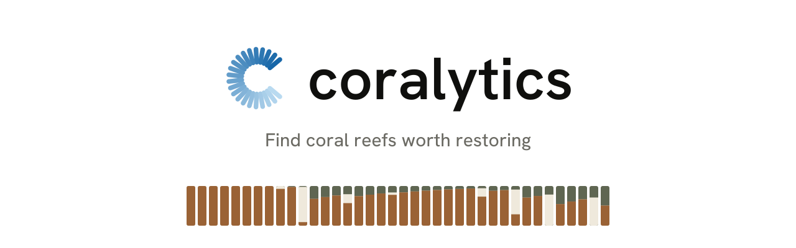
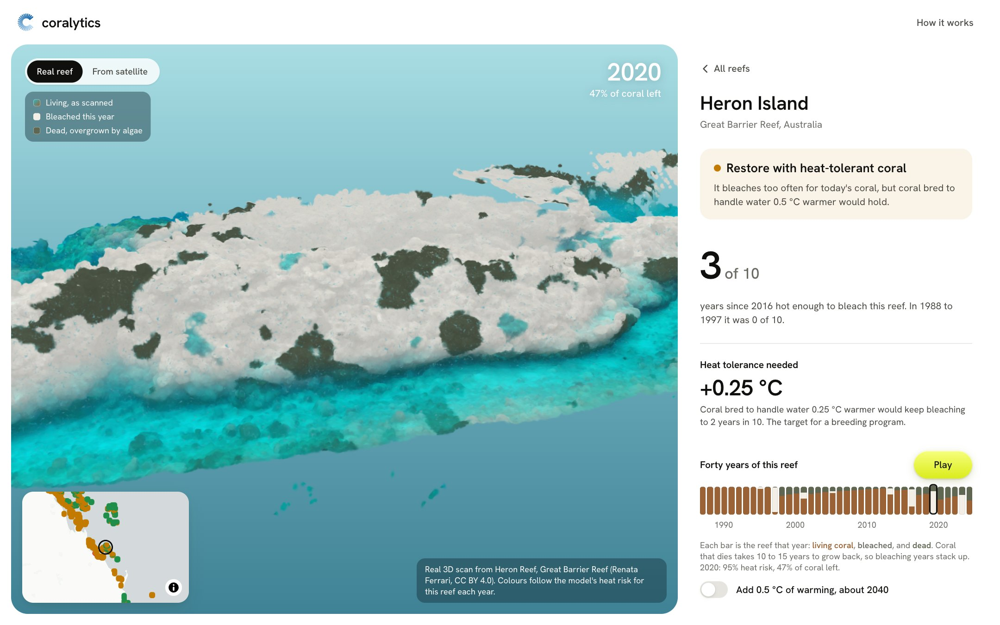

<p align="center">
  <picture>
    <source media="(prefers-color-scheme: dark)" srcset=".github/assets/banner-dark.svg">
    
  </picture>
</p>

<p align="center">An open map that ranks 18,445 coral reefs by whether restoration there will survive the heat.</p>

<p align="center">
  <a href="LICENSE"></a>
  <a href="https://coralytics.pages.dev"></a>
</p>

<p align="center">
  <a href="https://coralytics.pages.dev">Live demo</a> · <a href="https://github.com/hridaya423/reef-margin/issues">Issues</a>
</p>

Coral restoration projects pick sites by logistics and recent damage, not by future heat. Coralytics scores every 5 km reef cell on how often heat bleaches it, how much tougher restored coral must be to hold, and what else stops it recovering. Restoration groups, funders and coral breeding programs can use it to choose sites.



## What it shows

| Question | Answer in the app | Source |
|---|---|---|
| Does heat let this reef recover? | Bleaching years in the last 10. Two or fewer means it holds. | LightGBM model on NOAA Coral Reef Watch daily sea temperature |
| How much tougher must coral be? | Heat tolerance needed, in °C, per reef. A target for breeding programs. | The same model, rerun with the reef in cooler water |
| Will a restored reef last? | Local pressure and larvae supply, ranked into "Best places to restore" | WCS local reef pressures (Andrello et al. 2022), 50 Reefs connectivity |
| What does this mean for the reef? | A real 3D scan of the nearest surveyed reef, bleaching and dying year by year | Open reef scans, CC BY 4.0 |
| What would people lose? | Reef tourism a year, people protected from flooding, and neighbours within 50 km | TNC Mapping Ocean Wealth, GHS-POP 2020 |
| What about future warming? | A switch adds 0.5 °C, about 2040 at today's rate of warming | Forster et al. 2025 |

## Evidence

- **Tested on unseen years.** The model trained on surveys up to 2013 and was scored on 2016 to 2020. It ranks 30% bleaching at 0.935 AUROC against 0.906 for NOAA's degree heating weeks (2,771 surveys).
- **Tested on new surveys.** The model scores 201 MERMAID surveys from 2021 to 2025 in 10 countries at 0.84 AUROC. These surveys came after the training data.
- **Restoration sites ignore heat.** The 304 projects in Boström-Einarsson et al. (2020) list why they chose each site. None names heat or bleaching. With 0.5 °C more warming, 66% of the 224 projects near a scored reef sit on reefs too hot for today's coral.
- **Protection matters.** In MERMAID surveys, each bleaching year costs 1.9 points of coral cover, and no-take reserves hold 3.2 points more.

Run `tools/mermaid_check.py` to reproduce the MERMAID numbers.

> [!NOTE]
> The yearly bleaching and death in the 3D view is illustrative. It applies 40% mortality to bleached coral and 14% regrowth a year. The bleaching risk itself comes from the model.

## Quickstart

Run the web app against the public API:

```sh
cd web
npm install
echo "VITE_API_URL=https://hridayahoney--reef-response-api-web.us-east.modal.run" > .env.local
npm run dev
```

Open the URL that Vite prints. The map, rankings and reef panels load from the API.

The 3D scans are not in git (about 300 MB). Rebuild them into `web/public/scans/`:

```sh
tools/fetch_scans.sh
```

Set `SKETCHFAB_TOKEN` to also fetch the Sketchfab scans. The script needs `uv` and `curl`.

## Model pipeline

`reef_app.py` is a [Modal](https://modal.com) app. It downloads NOAA Coral Reef Watch data, builds features, trains the models and serves the API.

```sh
modal run reef_app.py --stage prep
modal run reef_app.py --stage features
modal run reef_app.py --stage trees
modal run reef_app.py --stage export
modal deploy reef_app.py
```

The pipeline needs a Modal account. A full run takes several hours of cloud compute.

## Data

| Data | Use | License |
|---|---|---|
| NOAA Coral Reef Watch CoralTemp | Daily sea temperature since 1985 | Public domain |
| Global Coral Bleaching Database (van Woesik and Kratochwill 2022) | Training labels | CC BY 4.0 |
| MERMAID (WCS) | Independent validation | CC BY 4.0 |
| WCS local reef pressures (Andrello et al. 2022) | Local pressure ranking | MIT |
| Boström-Einarsson et al. 2020, Dryad | Restoration project sites | CC0 |
| Allen Coral Atlas | Habitat maps | CC BY 4.0 |
| Reef tourism (Spalding et al. 2017) and people protected from flooding (Burke and Spalding 2022), TNC Mapping Ocean Wealth | What people would lose, summed within 25 km of each reef | No licence stated; the app ships per-reef sums with credit |
| GHS-POP R2023A, epoch 2020 (Schiavina et al. 2023, JRC) | People within 50 km of each reef | CC BY 4.0 |
| Soneva and Wildflow, Galapagos_3D, Sketchfab contributors | 3D reef scans | CC BY 4.0, credited in the app |
| Smithsonian 3D | Coral models in the satellite view | CC0 |

## License

The code is MIT licensed. See [LICENSE](LICENSE). Each dataset keeps its own license.
